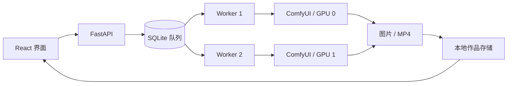

# 帧间 Studio

本地图片与短视频生成工作台，面向 RTX 3090 的单卡推理和多卡任务并发。输入提示词，选择画幅和生成参数，提交任务后查看作品、下载文件或复用参数。

第一版包括 SDXL 文生图、Wan 2.2 5B 文生视频和图生视频；视频输出为无声 MP4。多镜头剧本、角色一致性、配音和剪辑属于后续扩展。

## 代码与数据

```text
/home/zjr/Tracker/internship_project_lab/aigc_studio/
  frontend/          React + TypeScript 界面
  backend/           FastAPI、SQLite 队列、ComfyUI 适配器
  scripts/           安装、下载、启动和检查
  config/            Worker 配置示例、模型来源
  tests/             接口、并发、恢复、工具接口测试
  evaluation/        固定样本、测量协议、故障验收和报告脚本

/data/zjr/aigc_studio/
  venv/              API 环境
  comfy-venv/        推理环境，读取现有 PyTorch 的独立 overlay
  runtime/frontend/  Node 依赖；源码中的 node_modules 是兼容链接
  models/            模型权重、文件链接、下载版本 manifest
  cache/             Hugging Face、PyTorch、npm、浏览器缓存
  assets/            上传文件及生成作品
  studio.sqlite3     持久化任务和作品元数据
  web-dist/          前端构建结果
  run/               Worker 工作目录与进程锁
  checks/            隔离测试数据、报告、截图
  evaluations/       评测原始记录、生成作品、指标及审查页面
```

所有启动命令先加载 `scripts/env.sh`，将临时目录与模型缓存指向数据盘。推理环境不会安装或升级共享环境内的包。

## 启动

```bash
cd /home/zjr/Tracker/internship_project_lab/aigc_studio

# 首次安装；本机的 API 与 ComfyUI 环境已安装
bash scripts/setup.sh
bash scripts/setup_comfy.sh

# 下载模型；重复执行可续传。也可只传 --model sdxl 或 wan22
bash scripts/run.sh models --model all

# 构建页面，启动 API 和页面服务
bash scripts/run.sh build
bash scripts/run.sh serve
```

需要关闭终端后继续运行时，使用 `bash scripts/run.sh start` 启动用户级 API 服务，使用 `bash scripts/run.sh start-download` 在后台下载模型，使用 `bash scripts/run.sh start-worker` 后台等待空闲卡并启动推理服务。`bash scripts/run.sh status` 查看状态；日志在数据目录的 `logs/`。`bash scripts/run.sh stop` 停止 API，`bash scripts/run.sh stop-worker` 停止推理服务；`systemctl --user stop aigc-studio-download` 停止下载，已下载部分可续传。这些服务不会注册开机自启。

查看模型下载进度：

```bash
bash scripts/run.sh download-progress --watch
```

每 5 秒刷新各文件的已落盘大小、预计总大小和整体进度；按 Ctrl+C 只退出查看，不会停止下载。进度按临时文件大小估算，下载缓冲可能使它短时间不变；完成以文件登记为准。首次查询从模型仓库读取文件大小并缓存，后续只检查文件元数据，不扫描或哈希模型内容。查看下载错误及文件完成日志可用 `tail -f /data/zjr/aigc_studio/logs/aigc-studio-download.log`。

网络连接错误、超时、HTTP 429 或服务端错误会自动重试，等待从 15 秒逐步增加到最多 5 分钟；一轮重试耗尽后，后台服务等待 60 秒再启动。模型版本在下载前保存，续传继续使用相同版本及现有缓存。权限、文件不存在、磁盘空间不足等错误会明确停止。若显示 `inactive` 且文件未完成，说明服务已经停止，可以运行 `bash scripts/run.sh start-download` 恢复；进度窗口会显示当前文件、最近错误及重试状态。

下载器使用 HTTP Range 按字节续传，禁用会在重试时重新创建输出文件的 Xet 下载方式。首次切换时，将已有 Xet 临时文件保留为 `.xet-backup-*`，不把其重建结果直接当作 HTTP 连续前缀。需要主动停止下载时使用 `bash scripts/run.sh stop-download`。

另开终端启动推理服务：

```bash
cd /home/zjr/Tracker/internship_project_lab/aigc_studio
bash scripts/run.sh worker --gpu auto --port 18791 --wait
```

Worker 连续三次确认设备没有计算进程、显存基本空闲且利用率低后启动；`--gpu 0` 可指定物理卡号，也会检查占用。没有 `--wait` 时，无空闲卡直接退出。检查与本项目的文件锁只用于本机协作，不替代集群调度器。

页面与 API 默认监听服务器的 `127.0.0.1:18790`。在自己的电脑访问远程机器时，先建立端口转发：

```bash
ssh -L 18790:127.0.0.1:18790 zjr@<服务器地址>
```

随后用本机浏览器打开 `http://127.0.0.1:18790`。也可以使用 VS Code 的端口转发。当前是本地单用户应用，服务默认绑定回环地址。

当前默认读取 `/home/zjr/anaconda3/envs/chartvlm/bin/python` 的 PyTorch；换机器时，在安装前设置 `AIGC_TORCH_PYTHON` 为已有 CUDA PyTorch 环境的 Python 路径。可用 `AIGC_DATA_ROOT` 改变数据目录，但需要在新位置重新安装环境。

## 使用与调度

- 图片：SDXL，支持方图、横图、竖图；英文提示词通常更稳定，页面提供可直接使用的示例。
- 视频：Wan 2.2 TI2V 5B，默认 49 帧、16 fps，可选择约 2、3、5 秒。输出时长由帧数和播放帧率共同决定。
- 图生视频：上传 PNG/JPEG/WebP，服务完成解码校验和方向校正，然后把图片作为起始画面传给工作流。
- 模型未就绪时可以排队；就绪后由后台 Worker 自动领取。界面展示实际阶段，不估造采样百分比或剩余时间。
- 任务保存提示词、尺寸、种子、采样参数和输出引用。重试会创建新任务，保留原记录和种子。
- 最近任务和作品页目前展示最近 100 条任务中的记录；数据库和文件保留更早的历史。正式扩大使用时应增加分页与保留策略。



任务通过 SQLite 事务原子领取，每个 Worker 同时负责一个任务。调用 ComfyUI 的 `/prompt` 提交工作流，通过 `/history/{id}` 和 `/queue` 查询真实状态，用 `/view` 回收作品。取消只调用带任务 ID 的接口，不使用全局中断。若 API 在得到推理任务 ID 后重启，会恢复轮询；若恰好在提交与落库之间中断，则报告无法确认，交由用户检查后重试，以免自动重复生成。

## 多卡配置

把 `config/settings.example.json` 复制到 `/data/zjr/aigc_studio/settings.json`，增加独立的地址，然后重启 API：

```json
{
  "workers": [
    {"id": "image-0", "url": "http://127.0.0.1:18791", "models": ["sdxl"], "timeout_seconds": 7200},
    {"id": "video-1", "url": "http://127.0.0.1:18792", "models": ["wan22"], "timeout_seconds": 7200}
  ]
}
```

分别运行 `worker --gpu 0 --port 18791 --wait` 和 `worker --gpu 1 --port 18792 --wait`。这是多个独立任务使用多张卡，不会将一条视频切分到多卡。各卡可以共享同一份磁盘权重。

Worker 使用 `--lowvram` 和 ComfyUI 的模型卸载机制。3090 的实际峰值显存、速度和可用分辨率仍需按本机负载实测；当前还没有本项目的 GPU 性能结果。不要依据 24GB 容量或 CPU 接口检查推算生成时延。

## 检查

```bash
bash scripts/run.sh test
bash scripts/run.sh browser-install
bash scripts/run.sh browser-test

# 可选：用 CPU 检查真实 ComfyUI 参数与 MP4 编码；需要两个终端
bash scripts/run.sh worker --cpu --port 18801
bash scripts/run.sh diagnose-comfy
```

浏览器检查会自行启动、关闭隔离测试实例；测试中的图案图片只是夹具，不是生成效果示例。`checks/ui/` 保存桌面、手机、资源页截图与报告，`checks/comfy-report.json` 记录真实 ComfyUI 检查结果。

验证记录：41 项后端及评测单元测试通过，前端 TypeScript 与生产构建通过，浏览器 11 类操作检查通过且无浏览器运行错误，390px 手机页面无横向溢出。三条工作流的实际节点参数检查通过，CPU 测试图案到 MP4 的编码及作品回收通过。模型文件已完整；真实 GPU 生成等设备空闲后执行。

## 评测

方法与边界见 [评测协议](evaluation/PROTOCOL.md)，固定提示词与参数见 [protocol.json](evaluation/protocol.json)。质量维度参考 GenEval、VBench/VBench++，性能测量借鉴 MLPerf 的计时与负载区分；80 条自定义任务不属于这些基准的官方成绩。

```bash
# CPU 故障验收：真实 API 进程、隔离队列、模拟上游；不占 GPU
bash scripts/run.sh eval-faults
# 检查评测器自身的计时、下载、失败记录和视频完整解码
bash scripts/run.sh eval-check
# 后台等待空闲 GPU，执行三种模式检查、80 条任务、配对及 1/2 卡吞吐
bash scripts/run.sh start-evaluation
bash scripts/run.sh eval-status
tail -f /data/zjr/aigc_studio/logs/aigc-studio-evaluation.log
# 仅停止本轮评测及其子进程，不影响工作台或其他项目
bash scripts/run.sh stop-evaluation
```

评测独立使用 API 18810、推理 Worker 18811/18812，全部记录与作品保存到 `/data/zjr/aigc_studio/evaluations/acceptance-v1/`。状态、报告、逐任务 CSV、真实执行事件和资源采样随执行保存。中断后可重新启动：已结束任务保留，未确认的提交不会盲目复制；源码或协议改变后必须使用新 `--run-id`。评测使用默认节点缓存，并排除复用采样结果的任务。

`bash scripts/run.sh eval-review` 临时在本机 18813 端口提供审查目录；转发端口后打开 `http://127.0.0.1:18813/review.html`。每条作品附提示词及检查项，配对作品随机左右位置；评分暂存浏览器并可导出 JSON，未评分项保留为空。看完按 Ctrl+C 关闭这个临时服务器。

## 上游

生成后端使用 [ComfyUI](https://github.com/comfyanonymous/ComfyUI)，安装脚本固定在 `54a4e56ad1cabd17871068f160d0e75a1557db34`；升级后应重跑兼容性检查。Wan 工作流参考[官方 5B TI2V 模板](https://github.com/Comfy-Org/workflow_templates/blob/main/templates/video_wan2_2_5B_ti2v.json)。模型来源见 [SDXL 模型卡](https://huggingface.co/stabilityai/stable-diffusion-xl-base-1.0)、[Wan 官方仓库](https://github.com/Wan-Video/Wan2.2)和 `config/models.json`；下载器记录具体模型 revision。中文网页字体使用本地托管的 Noto Sans SC。
