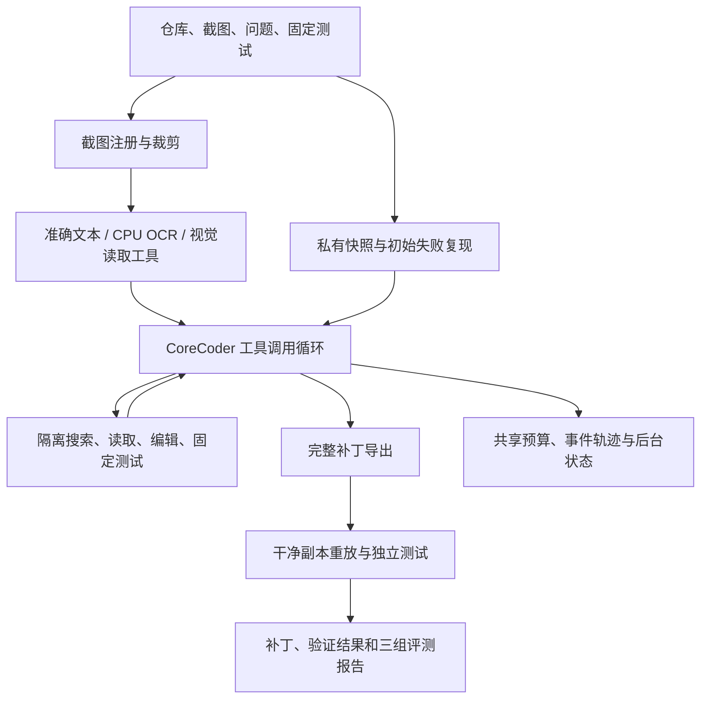

# 第一版演示与讲解

## 准备与运行

先按 README 构建 `datasets/generated/boltons_v1`，确认所选 GPU 空闲，然后运行已验证通过的 URL 连续导航案例视觉组：

```bash
SCA_GPU=7 SCA_LIMIT=1 SCA_READERS=vlm \
  SCA_MANIFEST=datasets/generated/boltons_v1/boltons_url_chained_navigation.jsonl \
  bash scripts/run_local_smoke.sh
```

本地模型加载占用一次启动时间，完成后模型自动退出。复现公开案例不需要训练或多张显卡。
另有 `sca repair --repo ... --image ... --problem ... --test-command ... --config ...` 用于用户自己的任务。

2026-10-22 完整评测中，该任务的准确文本、OCR 和视觉组均通过独立验证；视觉组耗时 42.5 秒。
这是单个公开历史案例的记录，完整成功率和其余失败见批次报告。
该次轨迹目录为 `outputs/full_eval_20261022T054515Z/evaluation/runs/boltons_url_chained_navigation_vlm`。

## 展示顺序

1. 展示输入截图、简短问题及完整错误仓库，说明截图来自哪个可复现错误版本。
2. 展示 `events.jsonl` 中的 `screenshot_read`：视觉模型返回的代码、文件/行号与不确定项。
3. 展示同一轨迹中的仓库搜索、源码读取和编辑，再展示固定 `run_tests` 输出。
4. 展示 `patch.diff`，以及 `baseline_test.log` 中的初始失败。
5. 展示 `verification_test.log` 和 `result.json` 的补丁重放/最终验证字段。
6. 展示完整三组报告，区分合成回归题、公开历史案例、dev/test/demo 与失败样本。

读取单次任务的关键事件：

```bash
.venv/bin/python - /path/to/run/events.jsonl <<'PY'
import json, sys
for line in open(sys.argv[1]):
    event = json.loads(line)
    if event['event'] in {'screenshot_read', 'tool_start', 'tool_error', 'run_finished'}:
        print(json.dumps(event, ensure_ascii=False))
PY
```

## 架构与贡献



CoreCoder 提供基础工具调用循环和上下文压缩；本项目增加截图读取/裁剪、隔离仓库工具、
统一调用预算、任务状态与停止、私有基准及干净副本验证、可复现截图任务与三组评测。
OCR、基础模型和开源修复本身均有独立来源，不作为自研算法或新修复成果。

简历可先描述已经实现的工程能力：

> 基于 CoreCoder 开发支持代码和终端报错截图的多模态代码修复 Agent，集成视觉读取、区域裁剪、
> 仓库检索与测试反馈循环；实现 Bubblewrap 隔离执行、调用预算、任务追踪及补丁独立重放验证，
> 构建准确文本、OCR 和视觉工具的同预算对照评测。

量化结果需引用实际完整报告，并同时给出独立任务数、来源和验证范围；不把回放通过数写成模型修复成绩。

已有可展示的失败复核：[闰年任务的仓库搜索循环](failure_review_v2.md)。
它说明理解报错、正确选择检索工具、生成补丁和独立验证是不同环节。
